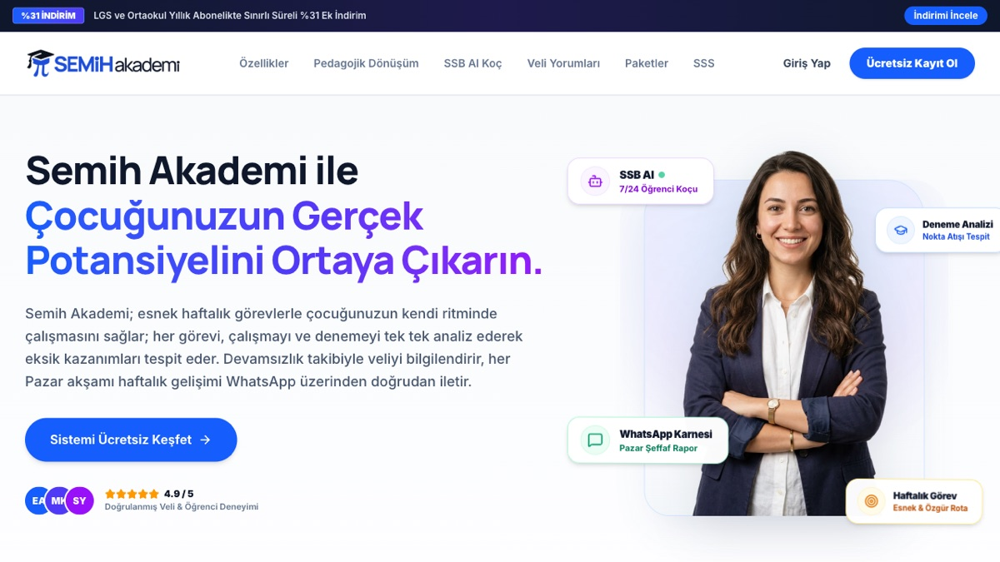
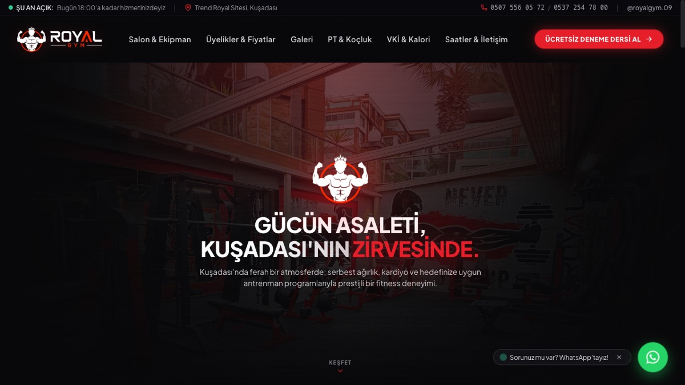
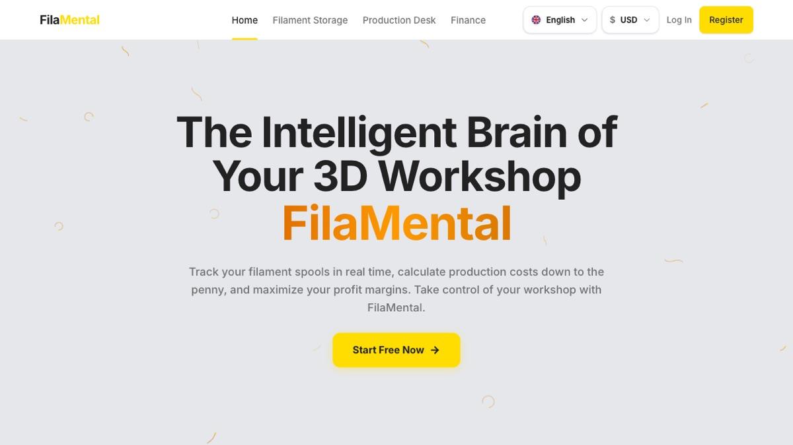

# Hi, I'm İsmail Arda Baran

**English** · [Türkçe](README.tr.md)

I'm a second-year Software Engineering student at Yaşar University and a full-stack developer. I like building software that people actually use, and AI is part of most things I build. Right now I'm running **Semih Akademi**, a study platform used by 13 students.

I'm open to internships and part-time roles in software, especially where AI is part of the product.

## Featured work

Most of my code lives in private repositories, because these are live products with real users. I'm happy to walk through the code in an interview.

### Semih Akademi

A study platform for middle school students in Türkiye. Students log their daily study, follow weekly plans and track practice exams; parents get a weekly progress report.

- 13 active students
- Built alone, end to end: student app, coach panel, backend
- AI study coach on the Claude API, prompt caching cut its running cost by 66%

`Next.js` `TypeScript` `Supabase` `Claude API`  
[Live site](https://semihakademi.com) · 🔒 Private repo

### Royal Gym Kuşadası

Website for a local gym, designed and built from scratch for a real client. I also run the gym's social media.

- Membership plans, photo gallery, BMI calculator
- Location, opening hours and WhatsApp contact

`React` `Vite` `Tailwind CSS` `Vercel`  
[Live site](https://www.royalgymkusadasi.com) · 🔒 Private repo

### FilaMental

A stock and cost tracker for 3D printing workshops, piloted with two workshops.

- Filament inventory that updates itself when a print is logged
- Print cost, profit margin, income and expense tracking
- Free and premium plans via Lemon Squeezy subscriptions

`Next.js` `TypeScript` `Supabase` `Lemon Squeezy`  
[Live site](https://fila-mental.vercel.app) · 🔒 Private repo

## Tech I use

  

Plus the **Claude API** for AI features: streaming responses, prompt caching and prompt design.

## Beyond code

- Ran hands-on AI workshops for teachers, including a 3-hour session for 30 teachers at a public education centre
- Spoke on AI ethics and practical AI at Erasmus+ school projects in Romania and Poland
- Volunteered for a month at an elderly care home in Italy with the European Solidarity Corps

## Contributions

<picture>
  <source media="(prefers-color-scheme: dark)" srcset="https://raw.githubusercontent.com/ismailardabaran/ismailardabaran/output/snake-dark.svg" />
  <source media="(prefers-color-scheme: light)" srcset="https://raw.githubusercontent.com/ismailardabaran/ismailardabaran/output/snake.svg" />
  
</picture>
