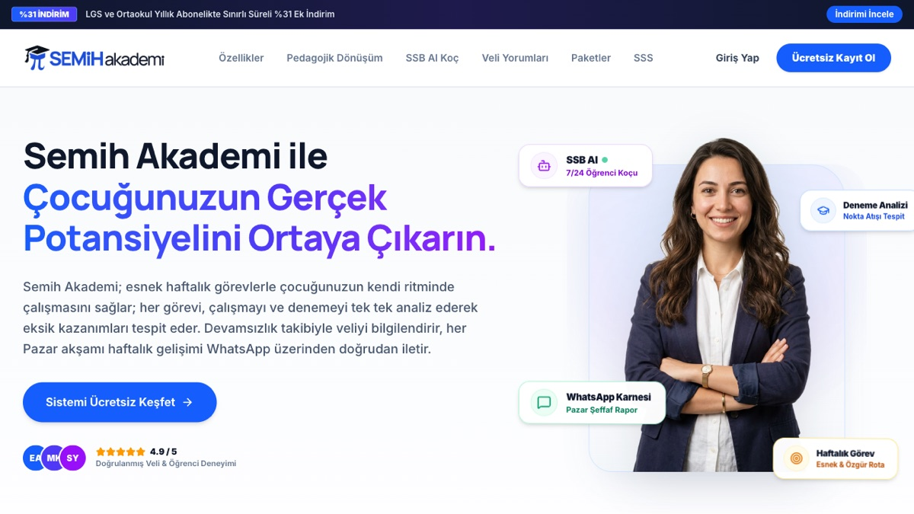
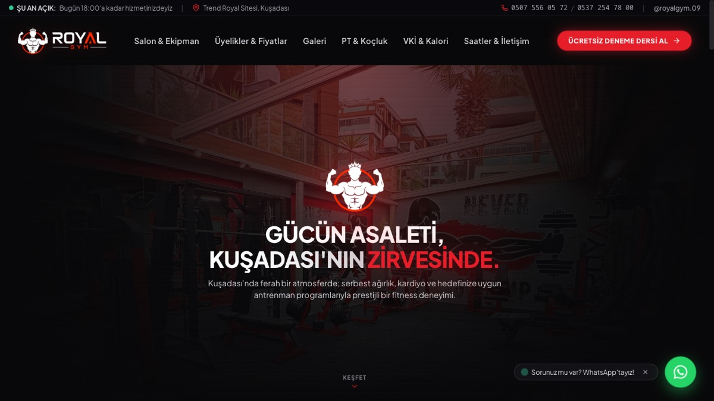
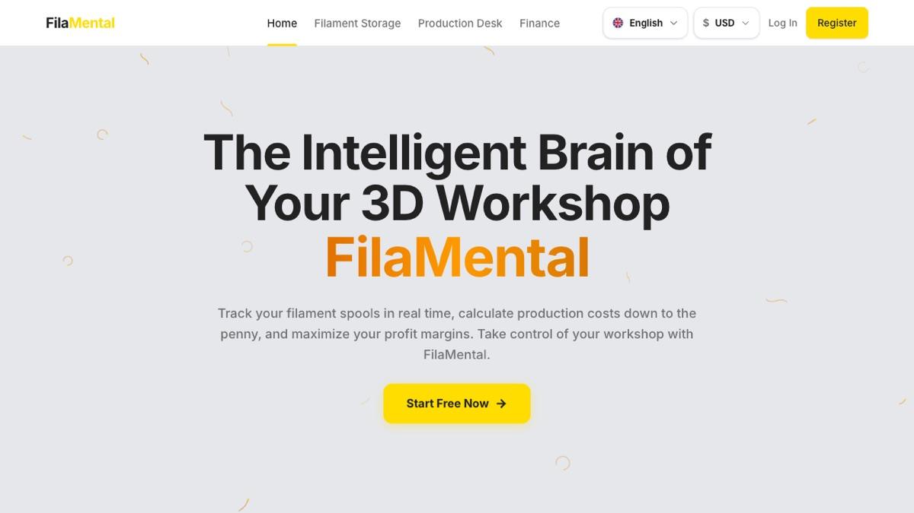

# Merhaba, ben İsmail Arda Baran

[English](README.md) · **Türkçe**

Yaşar Üniversitesi'nde Yazılım Mühendisliği 2. sınıf öğrencisiyim ve full-stack geliştiriciyim. İnsanların gerçekten kullandığı yazılımlar yapmayı seviyorum; yaptığım işlerin çoğunda yapay zeka da var. Şu an 13 öğrencinin kullandığı bir çalışma platformu olan **Semih Akademi**'yi yürütüyorum.

Yazılım alanında staj ve yarı zamanlı pozisyonlara açığım; özellikle yapay zekanın ürünün parçası olduğu yerlerde.

## Öne çıkan işler

Kodlarımın çoğu private repolarda, çünkü bunlar gerçek kullanıcısı olan, yayındaki ürünler. Mülakatta kodu birlikte incelemekten memnuniyet duyarım.

<table>
  <tr>
    <td width="46%"></td>
    <td>
      <h3>Semih Akademi</h3>
      Türkiye'deki ortaokul öğrencileri için bir çalışma platformu. Öğrenciler günlük çalışmalarını kaydediyor, haftalık planlarını takip ediyor ve denemelerini izliyor; veliler her hafta gelişim raporu alıyor.
      <ul>
        <li>13 aktif öğrenci</li>
        <li>Uçtan uca tek başıma geliştirdim: öğrenci uygulaması, koç paneli, backend</li>
        <li>Claude API üzerinde yapay zeka çalışma koçu; prompt caching ile çalışma maliyeti %66 düştü</li>
      </ul>
      <code>Next.js</code> <code>TypeScript</code> <code>Supabase</code> <code>Claude API</code>  
      <a href="https://semihakademi.com">Canlı site</a> · 🔒 Private repo
    </td>
  </tr>
  <tr>
    <td width="46%"></td>
    <td>
      <h3>Royal Gym Kuşadası</h3>
      Kuşadası'nda bir spor salonu için, gerçek bir müşteriye sıfırdan tasarlayıp geliştirdiğim web sitesi. Salonun sosyal medyasını da ben yönetiyorum.
      <ul>
        <li>Üyelik paketleri, fotoğraf galerisi, VKİ hesaplayıcı</li>
        <li>Konum, çalışma saatleri ve WhatsApp iletişimi</li>
      </ul>
      <code>React</code> <code>Vite</code> <code>Tailwind CSS</code> <code>Vercel</code>  
      <a href="https://www.royalgymkusadasi.com">Canlı site</a> · 🔒 Private repo
    </td>
  </tr>
  <tr>
    <td width="46%"></td>
    <td>
      <h3>FilaMental</h3>
      3D baskı atölyeleri için stok ve maliyet takip uygulaması; iki atölyeyle pilot olarak kullanıldı.
      <ul>
        <li>Baskı kaydedildiğinde kendini güncelleyen filament envanteri</li>
        <li>Baskı maliyeti, kâr marjı, gelir ve gider takibi</li>
        <li>Lemon Squeezy abonelikleriyle ücretsiz ve premium planlar</li>
      </ul>
      <code>Next.js</code> <code>TypeScript</code> <code>Supabase</code> <code>Lemon Squeezy</code>  
      <a href="https://fila-mental.vercel.app">Canlı site</a> · 🔒 Private repo
    </td>
  </tr>
</table>

## Kullandığım teknolojiler

  

Yapay zeka özellikleri için de **Claude API**: streaming yanıtlar, prompt caching ve prompt tasarımı.

## Kodun dışında

- Öğretmenlere uygulamalı yapay zeka atölyeleri verdim; bunlardan biri bir Halk Eğitim Merkezi'nde 30 öğretmenle 3 saatlik bir atölyeydi
- Romanya ve Polonya'daki Erasmus+ okul projelerinde yapay zeka etiği ve pratik yapay zeka kullanımı üzerine konuşmalar yaptım
- Avrupa Dayanışma Programı (ESC) kapsamında İtalya'da bir ay boyunca bir huzurevinde gönüllü olarak çalıştım

## Katkılar

<picture>
  <source media="(prefers-color-scheme: dark)" srcset="https://raw.githubusercontent.com/ismailardabaran/ismailardabaran/output/snake-dark.svg" />
  <source media="(prefers-color-scheme: light)" srcset="https://raw.githubusercontent.com/ismailardabaran/ismailardabaran/output/snake.svg" />
  
</picture>
